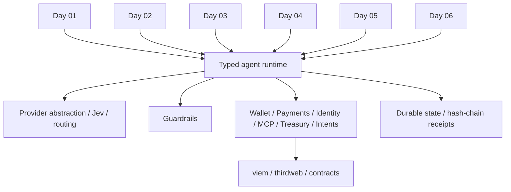

# Independent apps, composable capabilities

Each app exposes only its day-specific API entrypoint, environment and presentation. Shared source is bundled, not a remotely shared server. `dispatch(state, config, action, input)` selects capability handlers; an app cannot execute another day's tools. The shared runtime does not let the LLM build arbitrary transactions. NL output is validated through Zod and mapped into an approved capability. Authenticated operator requests initiate agents; separate human wallet signatures authorize owner transactions, job feedback and intents.

A configured Jev provider returns typed approve/reject, fit, abuse and small/large routing signals. Financial actions additionally pass deterministic constraints; classifier output never enlarges authority. The AI SDK uses a provider-compatible interface with configurable base URL, model names and key. Local parsers/classifiers/workers are deterministic and explicitly simulated. There is no hidden fallback from failed real inference to demo.

Real mode requires PostgreSQL. A partition key combines mode/day/operator; row locks serialize financial workflow requests. Operators should isolate databases or use distinct credentials for each independent deployment. Local mode serializes writes per cookie, atomically replaces files, and supports only one process. Receipts bind action, input, policy, result, mode, time, previous hash and optional chain transaction. Hashes detect edits relative to a retained trusted head; they are not signed/anchored identity proofs.

## Promotions justified by working apps

| Package | Why shared |
| --- | --- |
| config/types | Consistent validated environments and interoperable action/receipt schemas |
| agent-core | Provider routing, typed dispatch, auth and serialized storage for all six |
| guardrails | Financial bounds reused by wallet, toll, treasury and intents |
| receipts | Common inspectable evidence model for every tool |
| chain | RPC reads, simulated writes, mined receipt checks, exact human calldata |
| wallet | Smart-account connection and signature-bound session transfers |
| payments | Actual x402 protected resource and agent retry flow |
| identity | Programmatic registration, EIP712 feedback and validator commitments |
| mcp | SDK server/client and bounty lifecycle tooling, ready for future MCP skills |
| treasury | Observed ERC4626 rates, bounded allocation proposals and execution |
| intents | NL constraints, CoW schemas/signing/quotes/status and local solver ranking |
| ui | Common terminal primitives and receipt inspector with six distinct rooms |

Solidity contracts are separate from model authority. SessionVault caps USDC spend and validates session/owner signatures. QuestEscrow accounts for real transferred USDC and terminal settlement paths. FlightTreasury permits only allowlisted vaults of the configured asset and bounds allocation, liquidity, risk, size and duration. AgentPassport binds feedback signatures to a job/client, rejecting replay and owner feedback.

## Toward Day 31

A future composed agent can invoke `wallet.balance`, `payment.run`, `identity.inspect`, `bounty.discover/claim/submit`, `treasury.propose/execute` and `intent.draft/sign/status` through a capability registry. It receives its own state, owner controls, policy and receipt chain; no application-server dependencies are needed. MCP is already a real typed tool transport. Do not grant existing agent keys wider access merely to compose tools. New days should introduce narrowly scoped protocol adapters and integration tests rather than a speculative universal framework.

## Day 07 extension

See [Day 7 research](DAY-07-RESEARCH.md), [application and worker deployment](../apps/agents/day-07-glass-box-mind/README.md) and [Day 7 audit](DAY-07-AUDIT.md). Shared `packages/inference` provides signed model/input/output receipts, strict Intel DCAP and workload/model appraisal, opt-in sharing and owner-wallet onchain commitments. The independent verifier page checks ECDSA locally; hardware appraisal requires current Intel collateral and independently approved measurements. Demo keys and historical fixtures never confer hardware trust. Jev receives verification facts and cannot override failed cryptography. No other daily app server is required.

## Day 08 extension

[Research and acceptance](DAY-08-RESEARCH.md), [independent setup/deployment](../apps/agents/day-08-swarm-senate/README.md), and [final audit](DAY-08-AUDIT.md). Shared governance capabilities provide member-signed value mandates, two-round debate, Jev review/model routing, public transcript persistence, provisional delegate votes and onchain human overrides. OpenZeppelin GovernorCountingOverridable with VotesExtended prevents duplicate snapshot weight; a contract-enforced final window blocks agent votes while humans retain authority. Symbolic policy resolutions cannot transfer funds. No Snapshot, ElizaOS or other daily app server is required at runtime.

## Day 09 forecast capability

`packages/forecast` implements typed market creation, risk registration, bounded human/agent trade lanes, oracle evidence scoring, assertions/disputes, settlement, stale refunds and claims. Its pure analytics module is used by both API and Recharts presentation. The runtime dispatches Day 09 locally; no daily server is a dependency. `ForecastColosseum` owns collateral accounting, permanent agent classification and trade/per-market/daily caps. UMA alone resolves assertions. Human stake/bond actions return wallet calldata; the single configured server signer executes gated forecast trades and its own claims. PostgreSQL serializes each operator workspace, while onchain bounds remain authoritative for external direct callers. Rebuilding participants and positions from contract reads lets standings survive a service restart without fabricated outcomes.

## Day 10: public visitor checkpoint

`packages/checkpoint` composes shared chain, Jev/AI, config and receipts without routing through another daily app. It has its own public identity boundary rather than the single-operator dispatcher: signed visitor cookies, server-derived lanes, minimal projections and separately authenticated operator pause. Private World ID proofs bind the RP/action/nonce/recipient; canonical uniqueness is serialized globally under a stable PostgreSQL namespace. Returning passkeys preserve the verified identity and claim record. ERC-8004 identity authority is signed and rechecked on every agent query. The separate `/api/agents` forces public-information agent dispatch. Human chat never enters agent projections or AI context. Fixed rewards use an immutable campaign/token/verifier and durable contract claims; the server only issues short vouchers and a visitor wallet submits them. World ID verification is an offchain verifier trust boundary, not a claim that the reward contract verifies zero-knowledge proofs itself.

## Day 11 compute capability

`@dapptober/compute` exposes bounded provider discovery/ranking, human previews, agent-funded reservations, worker delivery and refunds. It compiles into its independent daily app. Provider workers verify funded job commitments and deliver from their own signer; they require no other daily server. Shared Supabase state remains partitioned by day/operator, while the contract is the authoritative escrow/capacity/cap ledger. WebSocket worker status is visual telemetry only; private provider tokens remain server configuration. Akash lease procurement and Base USDC job settlement are separate flows.

## Day 12 provenance capability

`@dapptober/provenance` composes approved-template selection, consent-gated Pinata metadata upload, immutable Base registration certificates, scoped license purchasing, recursive royalty credits/claims and public certificate/event queries. It reuses authentication, Supabase namespaces, chain validation and receipts; the 3012 app is independent. The custom Base registry does not implement Story/PIL; native Story interoperability remains an explicit network and implementation gap, preserving the fixed Base network requirement.

Day 13 promotes `packages/launchpad`: atomic thirdweb-based token/agent factories, perpetual reserve curves, holder revenue distribution, paid text job commitments/caching, risk narration, public feed and supplemental Dune analytics. It shares infrastructure at build time and requires no other daily server.

Day 14 promotes `packages/sentinel`: scoped policy custody, guardian/human EIP-712 permits, global revocation, Jev LangChain classification, MCP guard middleware, model routing and simulation. It is standalone and protects enrolled compartments; prior wallets require deliberate migration.

Day 15 promotes `packages/rwa`: issuer-reviewed catalogs, Centrifuge AsyncVault portfolio/requests/claims, Jev eligibility and source-bound AI explanations, Chainlink/NAV validation and exact investor wallet previews/receipts. No server signing authority or daily-server dependency is introduced.

## Day 16 — Brass

Day 16 adds @dapptober/bourse: independently deployable A2A seller actors and buyer negotiation, current registry verification, exact signed USDC settlement. Buyer and each seller use separate durable namespaces; no runtime coupling to earlier apps. The fixed escrow limits financial authority while seller keys only sign offers/delivery. See BOURSE-A2A.md.

## Day17 — Toe Tag

Day17 introduces reusable @dapptober/coroner evidence collection, typed risk/review, immutable report hashing and exact EAS publication. The always-reverting probe is diagnostic only; no server signer or token trades. Private Supabase namespace and standalone build17 preserve daily independence.

## Day18 — Hush

Day18 promotes `packages/confidant`: strict amount-free server routing/receipts and separate browser FHE wallet/encryption/decryption capability. Private data is excluded from the generic shared state: only categories and public chain metadata persist. EncryptedConfidant is an allocation ledger/auction, not custody. No earlier daily server is called.

Day20 promotes reproducible verification into `@dapptober/referee`: exact task commitments, Node re-execution, EIP712 verdicts, collateral previews, deterministic challenge/settlement, ERC8004 response publication and separate Eigen destination certificate inspection. It compiles into the independent Overrule app and never calls an earlier daily server. The Base share-bond contract is not a substitute claim for EigenLayer source restaking; source allocations/slashing relay remain an explicit integration boundary. Receipt status now includes pending to distinguish successful broadcast from mined confirmation without mutating historical receipt hashes.

## Day 23 — composable perp risk engineering

`packages/perps` adds pure long/short risk calculations, bounded exact order plans, a canonical native-venue snapshot adapter and typed Jev band/priority/model routing. These can be composed into later agents without the REDLINE server. `apps/agents/day-23-perp-pit-wall` owns its chart/WebSocket presentation, explicit browser-wallet approval and independent environment/deployment boundary. It does not depend on another daily runtime. Browser signing remains separate from model reasoning and server persistence: no server trading authority is delegated. The native Hyperliquid venue boundary is explicit and does not redefine the project's Base network configuration.

## Day 24 — mutual underwriting capability

`packages/mutual` composes Supabase state, private authorization, hash-linked receipts, typed Jev assessments, canonical evidence and pinned Base contract adapters. `AgentMishapMutual` reserves full policy limits, checkpoints nontransferable capital, excludes claimants from historical ballots and credits approved beneficiaries. The private office prepares exact browser-signed transactions; no model/server key spends capital. A finite season bounds exit locks. Premiums minus claims are member returns; no external yield protocol is claimed. Optional Snapshot Hub discussion mirrors are evidence/block/network-bound and advisory. See the Day 24 README/audit for governance, causal-evidence and operating limits.

## Day 25 — portable encrypted memory

`packages/memory` exposes browser Web Crypto/portable envelopes, Pinata/IPFS, versioned owner-controlled MemoryCathedral pointers and agent-specific RSA capsules. Actual MCP SDK request/read tools bind EIP-712 signer, purpose, public key, nonce, deadline and deployment; durable budgets and Jev metadata gates precede delivery. Agents decrypt locally, without another daily server or server-held private key. Rotation invalidates old-version grants; cached copies remain outside revocation. Supabase/receipts store only ciphertext, capsules, request metadata and authority history. This is a composable memory capability, not a plaintext global agent database.

## Day 26 — credentialed media

`packages/studio` composes bounded image generation, genuine C2PA sign/read, deterministic signed parent edits, independent Jev metadata gates, explicit public IPFS publication and exact EIP-712 mint permits. Its free ERC-721 credential drop records file/manifest/model/parent commitments and rejects replay or modified recipients. Creator wallet submits each mint; unified thirdweb reads pinned NFT evidence. Public file verification separates integrity, signer trust and onchain match. Private operator Supabase state has durable cost/project bounds; no other daily server is required.
